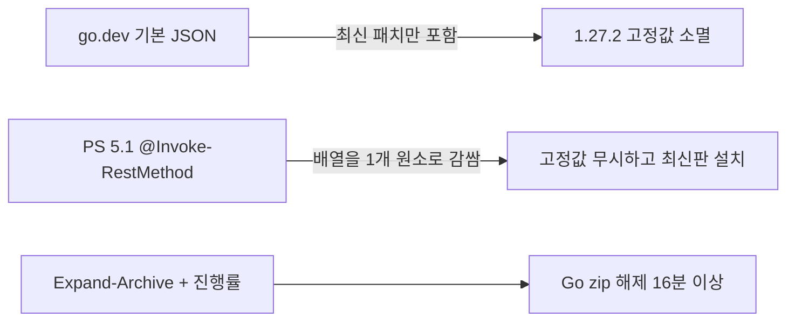

# 스크립트 점검 및 결함 수정 보고

일시: 2026-10-20 11:52 (KST)
호스트: Windows (PowerShell 5.1.26100, ko-KR/CP949) + WSL Bash

## 결과 요약

| 구분 | 수정 전 | 수정 후 |
|---|---|---|
| 구문 검사 (`bash -n`, PS Parser) | PASS | PASS |
| Linux 모의/경계 테스트 (facade, smoke×2, indep) | PASS | PASS |
| Linux Go 실설치 / session / global | 미실행(CRLF) 또는 FAIL | PASS |
| Linux langs / csharp+kotlin | 미실행(CRLF) | PASS |
| Windows 경계 테스트 (15건) | PASS | PASS |
| Windows Go 실설치 → build → prime → offline-check | FAIL (`Go 1.27.2 not found`) | PASS (187초) |
| Windows Python 실설치 | FAIL (호스트 App Control, 간헐적) | 세션 테스트에서 PASS (70초, go1.27.2 + Python 3.13.16) |

## 수정한 결함



1. **Go 고정 버전 설치 불가** (`setup.ps1`, `setup.sh`): `?mode=json`은 최신 패치만 반환하므로 새 패치가 나오면 기본값이 깨짐 → `&include=all`.
2. **PS 5.1 JSON 배열 래핑** (`setup.ps1` Go 설치, Go 최신화, Temurin): `@(Invoke-RestMethod ...)`가 `[전체배열]` 1개가 되어 버전 필터가 항상 참이 되고, 첫 zip(최신판)을 설치함. 최신화의 버전 문자열도 `"1.27.3 go1.26.10"`로 깨짐 → `| ForEach-Object { $_ }`.
3. **Windows 압축 해제/다운로드 극도로 느림**: `$ProgressPreference='SilentlyContinue'`, zip도 내장 `System32\tar.exe` 사용, 같은 볼륨이면 Copy 대신 Move.
4. **한글 메뉴 깨짐**: BOM 없는 `setup.ps1`을 PS 5.1이 CP949로 읽음 → UTF-8 BOM 추가.
5. **global-on/off가 사용자 Path의 `%VAR%`를 확장해 저장**: `Get-ItemProperty`는 REG_EXPAND_SZ를 확장함 → `GetValue(..., 'DoNotExpandEnvironmentNames')`.
6. **MSVC 오탐**: VS Build Tools가 설치돼 있어도 일반 터미널 PATH에는 `link.exe`가 없어 Rust 설치가 차단됨 → `vswhere` 탐지도 허용(`HasMsvc`).
7. **Linux update 롤백 무력화**: `if (install_go)` 안에서는 `set -e`가 꺼져 압축 해제 실패가 성공으로 처리되고 백업이 삭제됨 → `extract_one`에 명시적 `|| fail`.
8. **Linux Go 체크섬 파싱 SIGPIPE**: 대용량 JSON을 `printf | awk(exit)`로 넘기면 `pipefail`로 중단(141) → here-string.
9. `setup.sh` 도달 불가능한 중복 `install)` 분기 삭제, 테스트 `.sh` 4개 CRLF → LF.

## 남은 문제 (미수정)

- Windows Python: `uv trampoline failed ... os error 4551` = Windows App Control(WDAC/Smart App Control)이 `python\bin\python.exe` 트램펄린을 차단. 스크립트 결함이 아닌 호스트 정책.
- `dotnet-install`, `uv` 설치 스크립트 해시 미검증 (SPEC 8장에 기지 사항).
- `GlobalOn`이 `WM_SETTINGCHANGE`를 브로드캐스트하지 않아 Explorer에서 새로 연 터미널은 재로그인 전까지 반영되지 않을 수 있음.
- `.ps1` 설치 스크립트(dotnet/uv) 실행 직후 `AssertExit`은 이전 네이티브 명령의 `$LASTEXITCODE`를 검사함.
- Windows `configure -Mode verify`는 첫 실패에서 중단(Linux는 전체 집계).
- 미검증: Windows Rust/Kotlin/C# 실설치, 에뮬레이터 실기동, Tauri 번들, `_indep_global_win.ps1`(실제 HKCU 변경이라 실행 안 함).

## 재현

```powershell
powershell -File tests\_indep_go_install_win.ps1
powershell -File tests\_indep_win.ps1
```

```bash
wsl --cd /mnt/d/Projects/portable-build-kit -e bash tests/_indep_go_install_linux.sh
```
